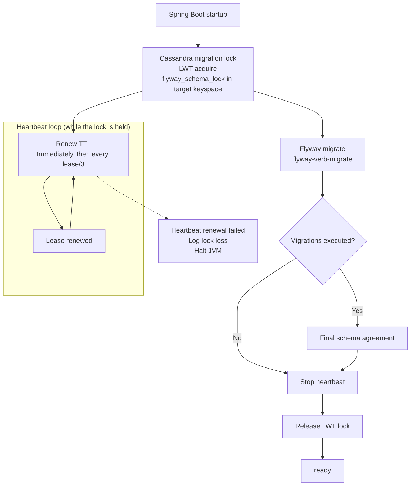

# spring-boot-starter-flyway-nc-cassandra

Cassandra support for [`spring-boot-starter-flyway-nc`](../../README.md) — Flyway's Native Connectors path applied to Apache Cassandra via the [`flyway-database-nc-cassandra`](https://documentation.red-gate.com/flyway/flyway-concepts/database-objects/database-native-connectors) module.

This starter:

- `api`-depends on the generic starter, so adding it is enough to get autoconfig + Cassandra wiring.
- Brings `org.flywaydb:flyway-database-nc-cassandra` as `runtimeOnly`.
- Contributes Spring Boot service-connection factories for Docker Compose and Testcontainers so `spring.flyway-nc.*` properties can be omitted in most setups.

## Installation

```kotlin
dependencies {
    implementation("io.github.rbleuse:spring-boot-starter-flyway-nc-cassandra")
}
```

See the [root README](../../README.md#installation) for the recommended setup with the Spring Boot Gradle plugin and the `spring-boot-flyway-nc-dependencies` BOM, plus the mandatory `FLYWAY_NATIVE_CONNECTORS=true` environment variable.

**Minimum Flyway version for starter 2.0:** 12.11.0. The `flyway-database-nc-cassandra` module itself was introduced in Flyway 12.5.0.

## Configuration

All `spring.flyway-nc.*` properties from the generic starter apply — see the [root README](../../README.md#configuration) for the full list. A minimal Cassandra configuration looks like:

```yaml
spring:
  flyway-nc:
    url: cassandra://localhost:9042?localdatacenter=datacenter1
    default-schema: my_keyspace
```

This starter defaults `spring.flyway-nc.migration-suffixes` to `[".cql"]` (Flyway's own default is `.sql`) and disables transactional execution because Cassandra migrations cannot be rolled back. This also lets Flyway record failed migrations in its schema-history table. A user `FlywayConfigurationCustomizer` can override either default.

### Distributed migration lock

The Cassandra-specific LWT lock is enabled by default. Its timings can be customized when several application instances may start concurrently:

```yaml
spring:
  flyway-nc:
    lock:
      lease-duration: 2m
      acquire-timeout: 10m
```



With the built-in migration strategy and locking enabled, the starter acquires the lock before calling `migrate()`, including when no migration is pending. As with Spring Boot, Flyway handles validation according to `spring.flyway-nc.validate-on-migrate`; the starter does not call `info()` or `validate()` explicitly. After acquiring the lock, `migrate()` resolves pending migrations again, so concurrent pods cannot execute the same migration.

The lock table persists. Each startup that acquires the lock reuses the same `lock_name`, then deletes the row when releasing it. If the process stops before release, Cassandra removes the row when its TTL expires.

The stored TTL rounds the lease up to whole seconds and adds one second to cover Cassandra's expiration precision. Heartbeat timings still use the configured lease duration.

When the configured schemas contain no application tables, the starter initializes an empty Flyway history table under the lock. The lock table alone does not trigger baselining or cause migrations to be skipped. Non-empty application schemas still follow the configured `baseline-on-migrate` and `baseline-version` settings.

If a heartbeat cannot renew the lease, the starter logs the failure and immediately halts the JVM. This deliberately favours safety over availability: the current pod cannot continue submitting CQL while another pod may acquire the expired lease.

The lock reuses Flyway's resolved connection details; it does not require a separate URL, username, password, or environment configuration. This includes URLs supplied by the Docker Compose and Testcontainers service-connection factories. The resolved URL must contain a keyspace: directly in its path, supplied by `CASSANDRA_KEYSPACE`, or appended from `spring.flyway-nc.default-schema`.

After a pod executes at least one migration, the starter performs a final schema-agreement check before releasing the lock. Schema agreement means that all nodes currently reported as `UP` expose the same schema version; it is not a structural diff of tables, columns, primary keys, UDTs, indexes, or table options. A lock, migration, validation, or final agreement failure prevents the application from becoming ready.

Set `spring.flyway-nc.lock.enabled=false` to opt out. The feature requires permission to create the lock table and support for Cassandra lightweight transactions. A target keyspace is required, just as it is for Flyway's Cassandra Native Connector.

The built-in migration strategy closes Flyway's Cassandra session after each `migrate()` call, including failures. This works around Flyway NC 12.11 leaving sessions open between operations. Cleanup remains enabled when the lock is disabled. During a locked startup, at most one Flyway session and one lock session are open at a time; all are closed afterwards. A user-defined migration strategy replaces this lifecycle handling too.

### Cassandra URL format

The Cassandra Flyway NC URL looks like:

```
cassandra://<host>:<port>[/<keyspace>]?localdatacenter=<dc>[&...]
```

- The path segment, if present, is the keyspace. Per the [URL schema handling rules](../../README.md#url-schema-handling), a path in the URL wins over `spring.flyway-nc.default-schema`.
- `localdatacenter` is required by the Cassandra driver.

### Docker Compose service connections

When `org.springframework.boot:spring-boot-docker-compose` is on the classpath alongside this starter, Cassandra compose services are detected automatically:

```yaml
services:
  cassandra:
    image: cassandra:5.0
    ports:
      - "9042"
    environment:
      CASSANDRA_DC: datacenter1
      CASSANDRA_KEYSPACE: my_keyspace
      CASSANDRA_USER: cassandra
      CASSANDRA_PASSWORD: cassandra
```

With the compose service running, you can omit `spring.flyway-nc.url`, `user`, and `password`. The factory reads:

- The mapped host and port for container port `9042`.
- `CASSANDRA_DC` or `CASSANDRA_DATACENTER` (defaults to `datacenter1`).
- `CASSANDRA_KEYSPACE` (optional; embedded in the URL path when set).
- Credentials from `CASSANDRA_USER` or `CASSANDRA_USERNAME` plus `CASSANDRA_PASSWORD`.

When `CASSANDRA_KEYSPACE` is omitted, configure `spring.flyway-nc.default-schema`. In both cases, the target keyspace must already exist before Flyway and the lock initialize.

### Testcontainers service connections

When `org.springframework.boot:spring-boot-testcontainers` is on the test classpath, a `CassandraContainer` annotated with `@ServiceConnection` supplies the connection details automatically:

```kotlin
@ServiceConnection
val cassandra = CassandraContainer(DockerImageName.parse("cassandra:5.0"))
    .withInitScript("cassandra-init.cql")
```

The factory derives the URL from the container's `contactPoint` and `localDatacenter`, and forwards the container's `username` / `password`. It does not embed a keyspace, so `spring.flyway-nc.default-schema` is required. The target keyspace must already exist; an init script such as `cassandra-init.cql` can create it before Flyway starts.

## Customizing migration startup

If you need to bootstrap a keyspace before Flyway runs (for example, because your application creates it dynamically rather than via Docker / Testcontainers init scripts), use a [`FlywayConfigurationCustomizer`](../../README.md#flywayconfigurationcustomizer) that takes the bootstrap bean as a constructor parameter — Spring will order the customizer behind it:

```kotlin
@Bean
fun keyspaceBootstrap(session: CqlSession) = FlywayConfigurationCustomizer { config ->
    session.execute(
        """
        CREATE KEYSPACE IF NOT EXISTS my_keyspace
        WITH replication = { 'class': 'SimpleStrategy', 'replication_factor': 1 }
        """.trimIndent()
    )
    config.defaultSchema("my_keyspace")
}
```

To skip migration entirely in tests, or to run `repair()` first, supply a [`FlywayNcMigrationStrategy`](../../README.md#flywayncmigrationstrategy) bean.

## Writing migrations

Place `.cql` files under `src/main/resources/db/migration/` (or wherever `spring.flyway-nc.locations` points). Flyway's standard `V<version>__<description>.cql` naming applies. This starter already defaults `spring.flyway-nc.migration-suffixes` to `[".cql"]` (Flyway's own default is `.sql`), so no extra configuration is needed unless you want a different suffix.

```cql
-- V1__create_users_table.cql
CREATE TABLE users (
    id uuid PRIMARY KEY,
    email text,
    created_at timestamp
);
```
